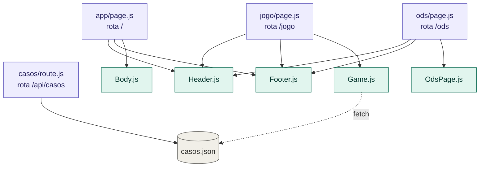
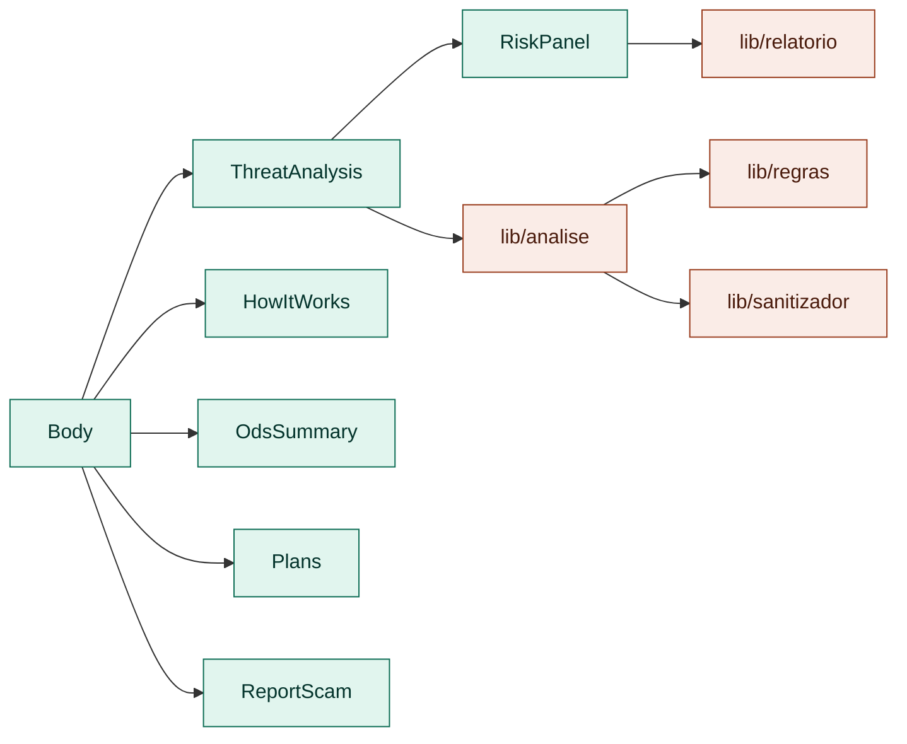
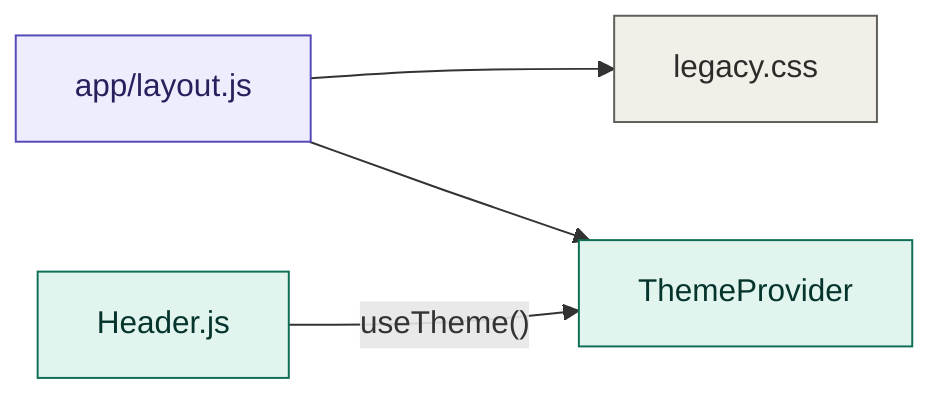

# AntiFraud

Projeto de identificação e prevenção de golpes digitais, originalmente desenvolvido com HTML, CSS e JavaScript, agora migrado para **Next.js + React** sem remover o conteúdo ou as funcionalidades da aplicação original.

## O que foi mantido

- Página inicial completa
- Análise de ameaça e painel de risco
- Indicadores e evidências sanitizadas
- Geração de relatório
- Como funciona
- ODS
- Planos
- Formulário de denúncia
- Alertas recentes
- Jogo educativo completo com os 8 casos originais
- Pontuação, acertos, níveis e progresso salvo em `localStorage`
- Página de ODS completa
- Tema claro/escuro
- Imagens e estilos originais

## Antes x Depois

| Antes | Depois |
|---|---|
| `index.html` | `app/page.js` + `components/Body.js` |
| `<header>` em cada HTML | `components/Header.js` reutilizável |
| `<footer>` em cada HTML | `components/Footer.js` reutilizável |
| Corpo inteiro dentro do HTML | Corpo convertido para componentes React |
| Seção de análise no HTML | `ThreatAnalysis.js` |
| Painel de risco manipulado pelo DOM | `RiskPanel.js` com estado React |
| Seção Como funciona no HTML | `HowItWorks.js` |
| Seção ODS resumida no HTML | `OdsSummary.js` |
| Planos no HTML | `Plans.js` |
| Denúncia no HTML | `ReportScam.js` |
| `jogo.html` + `jogo.js` | `app/jogo/page.js` + `components/Game.js` |
| `ods.html` | `app/ods/page.js` + `components/OdsPage.js` |
| `casos` dentro do JavaScript | `public/data/casos.json` |
| Manipulação manual do DOM | JSX + `useState` / `useEffect` |
| Arquivos HTML separados | Rotas do Next.js |
| JavaScript tradicional | Componentes React e módulos JS |

## Estrutura

```text
app/
├── page.js
├── jogo/page.js
├── ods/page.js
└── api/casos/route.js

components/
├── Body.js
├── Header.js
├── Footer.js
├── ThemeProvider.js
├── Game.js
├── OdsPage.js
└── home/
    ├── ThreatAnalysis.js
    ├── RiskPanel.js
    ├── HowItWorks.js
    ├── OdsSummary.js
    ├── Plans.js
    └── ReportScam.js

lib/
├── analise.js
├── regras.js
├── sanitizador.js
└── relatorio.js

public/
├── data/casos.json
└── images/
```

## Fluxo de dependências

Mapa de quem importa quem. A seta aponta de **quem puxa** para **quem é puxado**.
Os diagramas abaixo usam Mermaid, então aparecem renderizados direto no GitHub.

### 1. Rotas e componentes



### 2. Página inicial e cadeia de análise



### 3. Layout e tema



**Legenda:** roxo = rotas (`app/`), verde = componentes (`components/`), coral = lógica pura (`lib/`), cinza = dados e estilos. A seta tracejada é um `fetch`, não um `import`.

## JSON / API estática

Os casos do jogo ficam em `public/data/casos.json` e podem ser consumidos diretamente pelo frontend:

```js
const response = await fetch('/data/casos.json');
const casos = await response.json();
```

Também existe uma rota Next.js:

```text
GET /api/casos
```

Ela pode ser consumida com:

```js
const response = await fetch('/api/casos');
const casos = await response.json();
```

Para este projeto, a opção mais simples é consumir `/data/casos.json` diretamente. A rota `/api/casos` fica como uma camada de API do Next.js para demonstrar a arquitetura.

## Como executar

```bash
npm install
npm run dev
```

Acesse `http://localhost:3000`.

## Tecnologias

- Next.js
- React
- JavaScript
- HTML semântico / JSX
- CSS
- LocalStorage
- JSON

## Objetivo

O AntiFraud busca ajudar usuários a identificar sinais de golpes digitais, compreender padrões de engenharia social e organizar evidências para possíveis denúncias.
